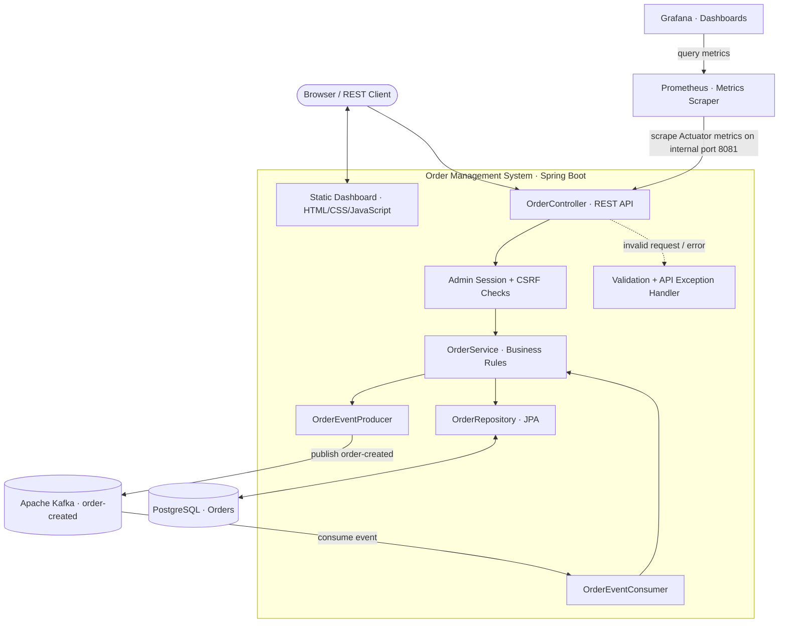
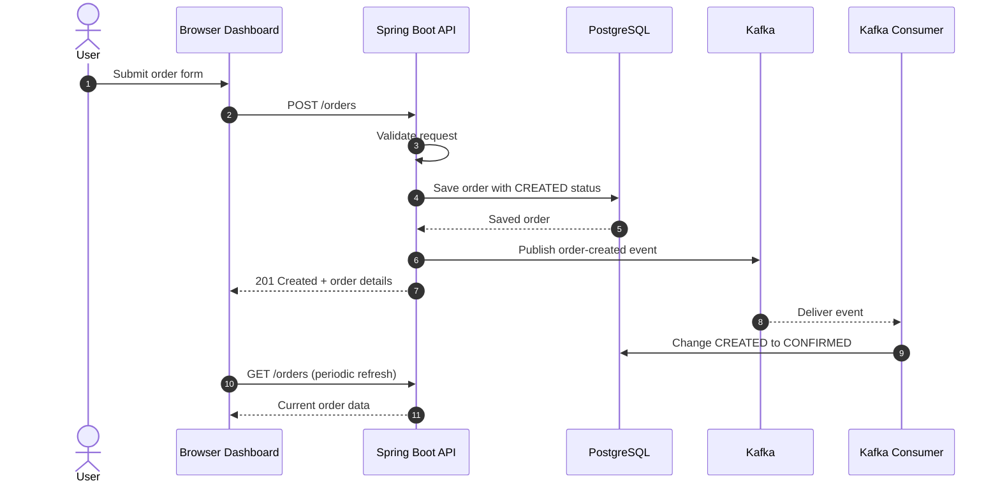
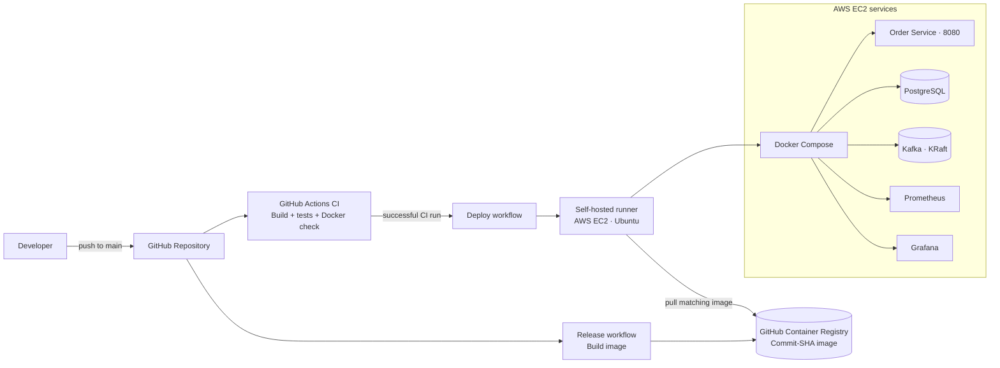

# 📦 Order Management System (OMS)

[](https://github.com/ankitRaj925/order-management-system/actions/workflows/ci.yml)


> *“From order creation to confirmation — powered by event-driven architecture.”*

**An event-driven Order Management System built with Spring Boot, PostgreSQL, and Apache Kafka.** It supports order creation through a web dashboard or REST API, asynchronous order confirmation, authenticated admin operations, Docker Compose, automated CI/CD, AWS EC2 deployment, and Prometheus/Grafana monitoring.

🌐 **Live Demo:** [Open Order Management System](http://54.252.24.231:8080/) · *Temporary EC2 link; it may be unavailable when the instance is stopped, and the public IP may change.*

---
---

## 🧭 Table of Contents

- [✨ Features](#-features)
- [🖼️ Screenshots](#️-screenshots)
- [🏗️ Architecture](#️-architecture)
- [🔄 Order Lifecycle](#order-lifecycle)
- [🧰 Technology Stack](#-technology-stack)
- [📁 Project Structure](#-project-structure)
- [🚀 Getting Started](#-getting-started)
- [⚙️ Configuration](#️-configuration)
- [🔌 API Reference](#-api-reference)
- [🧪 Testing](#-testing)
- [🚢 CI/CD and Deployment](#-cicd-and-deployment)
- [🛣️ Future Improvements](#️-future-improvements)
- [📄 License](#-license)
- [👤 Author](#-author)

## ✨ Features

### 📦 Order management

- Create and retrieve orders via REST API or web dashboard.
- Server-side validation and precise price handling with `BigDecimal` and PostgreSQL `NUMERIC(9,2)`.
- Asynchronous Kafka-based order confirmation.
- Enforced lifecycle: `CREATED` → `CONFIRMED` → `SHIPPED`, with invalid transitions rejected..

### 🔐 Admin operations

- Session-based admin authentication with CSRF protection.
- Ship or delete individual orders, with bulk operations and per-order results.

### 🖥️ Web dashboard

- Order statistics, status counts, total value, and fulfilment progress.
- Search by order ID, customer, or product; filter by status.
- Responsive light/dark themes, keyboard navigation, and automatic refresh every 3 seconds.

### ⚙️ Platform and operations

- Docker Compose for the application and supporting services.
- GitHub Actions CI/CD with GHCR image publishing and AWS EC2 deployment via a self-hosted runner.
- Prometheus metrics and Grafana dashboards.
- Kubernetes reference manifests (not validated on a live cluster)

## 🖼️ Screenshots

### 1. Application Dashboard — Dark Mode


### 2. Admin Login and Logout

<table>
  <tr>
    <th align="center">Admin Login</th>
    <th align="center">Admin Logout</th>
  </tr>
  <tr>
    <td></td>
    <td></td>
  </tr>
</table>

### 3. Grafana — Full Order Service Dashboard


<details>
<summary><strong>More screenshots</strong></summary>

#### Application Dashboard — Light Mode


#### Grafana — Request Rate


#### Grafana — Order Service Status


#### Grafana — Total HTTP Requests


#### Grafana — JVM Memory Used


#### Prometheus Targets


#### Docker Compose Services


</details>

## 🏗️ Architecture

The system is organized as a Spring Boot application with a relational database, Kafka messaging, and a separate metrics-and-dashboard path. Docker Compose runs the application and its supporting services on a shared host/network.

### 1. 🧩 Application and service architecture



| Component | Responsibility |
|---|---|
| **Order Service** | Serves the dashboard and REST API; applies validation, business rules, and admin checks. |
| **PostgreSQL 16** | Persists order records. |
| **Apache Kafka 3.9 (KRaft)** | Carries the `order-created` event without requiring ZooKeeper. |
| **Prometheus** | Scrapes metrics from the Order Service and its own health/metrics endpoint. |
| **Grafana** | Displays metrics from Prometheus using a configured data source and dashboard. |

### 2. 📨 Order creation sequence

This sequence describes the implemented high-level behavior: the API stores the order as `CREATED`, publishes an event, and the consumer confirms it asynchronously. The dashboard polls for updated data.



> The database write and Kafka publish are separate operations in this design. This README does not claim distributed transaction or exactly-once guarantees.

<a id="order-lifecycle"></a>

### 3. 🚦 Implemented order lifecycle

`CREATED` → `CONFIRMED` → `SHIPPED`

- Kafka consumer: `CREATED` → `CONFIRMED`
- Authenticated admin: `CONFIRMED` → `SHIPPED`

These are the implemented statuses documented by the project. `CANCELLED` and `DELIVERED` are not currently claimed as implemented states.

The deployment and CI/CD flow is shown once in the CI/CD section below to avoid repeating similar diagrams.

The public application endpoint is served on port `8080`. The monitoring, database, and Kafka ports are configured for local-only access in the EC2 Compose setup; verify the active security group and Compose bindings before changing exposure.

## 🧰 Technology Stack

<p align="center">
  
  
  
  
  
  
  
</p>
<p align="center">
  
  
  
  
  
  
  
</p>

<details>
<summary>Technology details</summary>

| Area | Technology | Role |
|---|---|---|
| Language and framework | Java 17, Spring Boot | Application and REST API |
| Persistence and validation | Spring Data JPA / Hibernate, Jakarta Bean Validation | Database access and request validation |
| Database | PostgreSQL 16 | Order storage |
| Messaging | Apache Kafka 3.9 (KRaft), Spring Kafka | Asynchronous order events |
| Frontend | HTML, CSS, vanilla JavaScript | Dashboard served by Spring Boot |
| Build and containers | Maven Wrapper, Docker, Docker Compose | Build and runtime |
| CI/CD and cloud | GitHub Actions, GHCR, AWS EC2, self-hosted runner | Build, publish, and deploy |
| Monitoring and tests | Actuator, Micrometer, Prometheus, Grafana, JUnit 5 | Metrics and automated tests |

</details>

## 📁 Project Structure

```text
order-management-system/
├── .github/
│   └── workflows/
│       ├── ci.yml                  # Build, tests, Docker build check
│       ├── release.yml             # Build and publish image to GHCR
│       └── deploy.yml              # Deploy through the EC2 self-hosted runner
├── .mvn/wrapper/                   # Maven Wrapper configuration
├── docs/
│   └── images/                     # README screenshots
├── k8s/                            # Reference Kubernetes manifests
├── monitoring/
│   ├── prometheus.yml              # Prometheus scrape jobs
│   ├── grafana-datasource.yml      # Grafana data source
│   └── grafana-dashboard.json      # Dashboard definition
├── src/
│   ├── main/java/com/ankit/orderservice/
│   │   ├── Order.java
│   │   ├── OrderController.java
│   │   ├── OrderService.java
│   │   ├── OrderRepository.java
│   │   ├── OrderEventProducer.java
│   │   ├── OrderEventConsumer.java
│   │   ├── KafkaTopicConfig.java
│   │   ├── AdminSessionService.java
│   │   ├── ApiExceptionHandler.java
│   │   └── OrderExceptions.java
│   ├── main/resources/
│   │   ├── application.properties
│   │   └── static/index.html
│   └── test/java/com/ankit/orderservice/
├── .env.example                    # Safe configuration template
├── .gitignore
├── Dockerfile                      # Multi-stage image build
├── docker-compose.yml
├── docker-compose.local.yml        # Local development override, if present
├── mvnw
├── mvnw.cmd
├── pom.xml
└── README.md
```

### Important application components

| Class / component | Responsibility |
|---|---|
| `Order`, `OrderStatus` | Order entity and supported status values |
| `OrderController` | REST endpoint handling |
| `OrderService` | Business logic, transitions, and deletion |
| `OrderRepository` | Database access through Spring Data JPA |
| `OrderEventProducer` | Publishes order events to Kafka |
| `OrderEventConsumer` | Processes order events and confirms eligible orders |
| `KafkaTopicConfig` | Kafka topic/configuration setup |
| `AdminSessionService` | Admin session-related logic |
| `ApiExceptionHandler`, `OrderExceptions` | Consistent error handling and HTTP responses |

## 🚀 Getting Started

### Prerequisites

- Git
- Docker Desktop or Docker Engine with the Compose plugin
- JDK 17 if you want to run Maven tests outside the container
- PowerShell on Windows, or Bash on Linux/macOS

### 1. Clone the repository

```bash
git clone https://github.com/ankitRaj925/order-management-system.git
cd order-management-system
```

### 2. Create your local environment file

**Windows PowerShell:**

```powershell
Copy-Item .env.example .env
```

**Linux/macOS:**

```bash
cp .env.example .env
```

Edit `.env` and set strong local values for the database and admin credentials. Never commit the populated `.env` file.

### 3. Validate the Compose configuration

```bash
docker compose -f docker-compose.yml -f docker-compose.local.yml config
```

If the repository does not contain `docker-compose.local.yml` in your checkout, create it for a source build with this content:

```yaml
services:
  order-service:
    build: .
```

### 4. Build and start the local stack

```bash
docker compose -f docker-compose.yml -f docker-compose.local.yml up -d --build
```

To use the published image instead, configure `OMS_IMAGE_TAG` as needed and run the base Compose configuration:

```bash
docker compose up -d
```

The published image is `ghcr.io/ankitraj925/order-management-system`; the configured tag is selected by `OMS_IMAGE_TAG`.

### 5. Check service status and logs

```bash
docker compose -f docker-compose.yml -f docker-compose.local.yml ps
docker compose -f docker-compose.yml -f docker-compose.local.yml logs --tail=100
```

### 6. Open the local services

| Service | Local URL | Notes |
|---|---|---|
| Application and dashboard | [http://localhost:8080](http://localhost:8080) | REST API and web UI |
| Grafana | [http://localhost:3000](http://localhost:3000) | Dashboard UI; use configured credentials |
| Prometheus | [http://localhost:9090](http://localhost:9090) | Targets and metrics UI; local configuration may use a Compose override |

For a fresh Grafana setup, use the credentials configured for your environment and change any default password immediately. Import `monitoring/grafana-dashboard.json` if the dashboard is not provisioned automatically.

### 7. Stop the stack

```bash
docker compose down
```

This removes the containers and network while normally retaining named volumes. **Warning:** `docker compose down -v` deletes the associated volumes and can permanently delete local database data.

## ⚙️ Configuration

The supported variables should match `.env.example` and the Compose/application configuration.

| Variable | Purpose |
|---|---|
| `POSTGRES_USER` | PostgreSQL user |
| `POSTGRES_PASSWORD` | PostgreSQL password |
| `POSTGRES_DB` | Database name |
| `OMS_IMAGE_TAG` | Application image tag; deployments can use the commit SHA |
| `ADMIN_USERNAME` | Admin login name |
| `ADMIN_PASSWORD` | Admin login password |

Do not paste real secrets into the README, issue reports, screenshots, or Git history. Keep `.env` local and commit only the placeholder-based `.env.example`.

### Ports and exposure

| Port | Service | Intended exposure in the EC2 setup |
|---:|---|---|
| `8080` | Order Service / dashboard | Public application endpoint, subject to security-group rules |
| `8081` | Actuator / Prometheus metrics | Internal Docker network; not published publicly |
| `3000` | Grafana | Bound to `127.0.0.1` for local/tunnel access |
| `9090` | Prometheus | Bound to `127.0.0.1` for local/tunnel access |
| `5432` | PostgreSQL | Bound to `127.0.0.1` for local administration |
| `9092` | Kafka | Bound to `127.0.0.1` on the host; container-to-container access uses the configured Docker network |

Actual port exposure depends on the Compose file and cloud firewall/security-group rules currently deployed. Verify both before changing access.

## 🔌 API Reference

**Local base URL:** `http://localhost:8080`  
**Request/response format:** JSON, unless an endpoint specifies otherwise.

### Public order endpoints

| Method | Path | Description |
|---|---|---|
| `POST` | `/orders` | Create an order; returns `201 Created` with the saved order |
| `GET` | `/orders` | List orders |
| `GET` | `/orders/{id}` | Retrieve an order by ID; returns `404` if missing |

#### Example: create an order

```bash
curl -X POST http://localhost:8080/orders \
  -H "Content-Type: application/json" \
  -d '{"customerName":"Asha","productName":"Laptop","quantity":2,"price":55000.50}'
```

Example response shape (values and timestamps vary):

```json
{
  "id": 1,
  "customerName": "Asha",
  "productName": "Laptop",
  "quantity": 2,
  "price": 55000.50,
  "status": "CREATED",
  "createdAt": "2026-10-18T10:15:30.123456"
}
```

### Admin endpoints

Admin operations require an authenticated session. State-changing requests must include the CSRF token returned by the login/session endpoint in the `X-CSRF-Token` header.

| Method | Path | Description |
|---|---|---|
| `POST` | `/orders/admin/login` | Authenticate admin; returns session-related information and CSRF token |
| `GET` | `/orders/admin/session` | Get the current session; returns `401` when not authenticated |
| `POST` | `/orders/admin/logout` | End the admin session |
| `PUT` | `/orders/{id}/ship` | Ship an eligible `CONFIRMED` order |
| `DELETE` | `/orders/{id}` | Delete an order |
| `POST` | `/orders/admin/ship-bulk` | Ship multiple order IDs; includes per-order results |
| `POST` | `/orders/admin/delete-bulk` | Delete multiple order IDs; includes per-order results |

Example bulk request body:

```json
{"ids": [1, 2, 3]}
```

Bulk responses include a summary and an individual result for each requested order ID.

### Error responses

Validation and business errors use a consistent JSON shape, for example:

```json
{"errors": ["Quantity must be at least 1"]}
```

| HTTP status | Meaning |
|---:|---|
| `400` | Invalid request data |
| `401` | Missing/expired admin session or authentication required |
| `403` | Request is forbidden, including applicable CSRF failures |
| `404` | Order not found |
| `409` | Invalid order status transition |


## 🧪 Testing

Run the test suite from the project root.

**Windows PowerShell:**

```powershell
.\mvnw.cmd clean test
```

**Linux/macOS:**

```bash
./mvnw clean test
```

The repository's tests cover order creation, input validation, price/quantity limits, order status transitions, Kafka confirmation rules, and admin/session behavior. The unit test suite is designed to run without starting a separate database or Kafka service.

Check the real output for `BUILD SUCCESS`, zero failures, and zero errors. Test counts can change as tests are added; this README intentionally does not claim a fixed count.

## 🚢 CI/CD and Deployment



| Workflow | Purpose |
|---|---|
| `.github/workflows/ci.yml` | Builds the application, runs unit tests, and checks the Docker image build on pushes and pull requests to `main`. |
| `.github/workflows/release.yml` | Builds and publishes the container image to GHCR for pushes to `main`. |
| `.github/workflows/deploy.yml` | Deploys after the configured successful CI trigger, using the self-hosted runner on EC2. |

The EC2 runner initiates an outbound connection to GitHub; the deployment design does not require GitHub-hosted infrastructure to SSH into the instance. The exact workflow triggers and job dependencies are defined in the YAML files and should be reviewed there if they change.

### ☁️ AWS EC2 Deployment

The application is deployed on an Ubuntu AWS EC2 instance using Docker Compose. GitHub Actions builds and publishes the container image to GitHub Container Registry, and the configured self-hosted runner on EC2 performs deployment.

- **Live application:** [http://54.252.24.231:8080](http://54.252.24.231:8080) *(temporary; available only while the instance and application are running; the IP may change)*
- **Deployment workflow:** `.github/workflows/deploy.yml`
- **Container image:** `ghcr.io/ankitraj925/order-management-system`
- **Kubernetes:** reference manifests are available in `k8s/`; they are not part of the documented live deployment path.

Keep database, Kafka, Prometheus, and Grafana ports restricted. Do not publish credentials, SSH keys, or private environment files.

## 🛣️ Future Improvements

- 🔒 Add HTTPS/TLS for secure browser and API traffic.
- 🔑 Use managed secrets and strengthen production credential rotation.
- 🗃️ Add database migrations and automated backups with tested restore procedures.
- 📨 Improve Kafka retry, dead-letter, and idempotency handling as needed.

## 📄 License

This project is licensed under the [MIT License](LICENSE).

## 👤 Author

**Ankit Raj** · [GitHub Profile](https://github.com/ankitRaj925)

---

<p align="center">Built and deployed an event-driven Order Management System</p>
